# YTKACE

An open-source YouTube enhancement for iOS.

## Features

| Area | Included |
|---|---|
| Downloads | Video, audio, Shorts and whole-playlist downloads; save to the library, Photos or the share sheet; sorting; backup and restore |
| Queue | Play next or play last without Premium, with reorder, swipe to remove, shuffle, loop and clear |
| Playback | Background playback, PiP, loop, speed controls, default speed, gestures, tap to seek and an HLS playback mode |
| SponsorBlock | Category controls, progress markers, skip modes and configurable alerts |
| Interface | OLED mode, overlay controls, navigation cleanup and native share sheets |
| Liquid Glass | Glass tab bar, top bar buttons, menus, sheets, player buttons and YTKACE popups on iOS 26, with shrink on scroll and a selected tab color |
| Tabs | Hide, reorder and add YouTube destinations |
| Library | Downloaded video, Shorts and audio players with resume support |
| Settings | Searchable settings, 15 languages and a native YouTube settings section |

## Compatibility

- **iOS:** 15.0 and newer (tweak packages); the prebuilt IPAs follow their YouTube base
- **Architecture:** arm64
- **YTKACE:** 1.1.3

YouTube 21.41.5 requires iOS 17, so two IPAs are published:

| IPA | YouTube base | iOS |
| --- | --- | --- |
| `YTKACE_1.1.3_YouTube_iOS16_21.33.6.ipa` | 21.33.6 | 16.0 and newer |
| `YTKACE_1.1.3_YouTube_21.41.5.ipa` | 21.41.5 | 17.0 and newer |

Pick the 21.41.5 build unless you are on iOS 16. Either one installs with TrollStore or a developer-certificate sideloader.

## Install

**Jailbroken.** Add the repository in Sileo, Zebra or Cydia:

```
https://itzzace.github.io/ytkace/
```

Rootless and roothide packages are both published. The repository page also has an
[Add to Sileo](https://itzzace.github.io/ytkace/) button.

**Sideloaded.** Download the IPA for your iOS version from the [latest release](https://github.com/itzzace/ytkace/releases/latest) and install it with TrollStore, AltStore, SideStore or LiveContainer.

## Build

Fork the repository, enable Actions, open the **IPA** workflow and provide a direct link to a decrypted YouTube IPA you are legally allowed to use. The completed workflow provides the injected IPA as an artifact. The **Deb** workflow builds the tweak package.

To build both IPAs in one run, fill in the second URL field as well: the workflow takes an iOS 16 base (21.33.6) and an optional iOS 17+ base (21.41.5), and uploads them as separate artifacts. Leaving the second field empty builds a single IPA.

## Settings

Open the YTKACE tab and tap the gear, or open YouTube Settings and choose YTKACE.
Both pages carry the same options, and the YouTube Settings section has a search bar.

When the integrated CaptionIsland factory is loaded, **Caption Island** appears in this
menu and search. The bridge resolves the factory on use, so standalone YTKACE has no
hard dependency on CaptionIsland. **General → Use System Menus** selects UIKit list
sheets/popovers for tweak-owned choices, download menus, library actions, transcripts
and sleep timers. Menus use an explicit `UIGlassEffect` background when supported,
respect Reduce Transparency, and retain their original action callbacks. This does
not replace every server-driven YouTube menu; native host menus need separate adapters.

### Player controls

YTKACE owns its player buttons, including the integrated YouQuality-style shortcut.
Enable **Quality Button** under **Video Quality**. The text opens YouTube's native
quality selector; its selected-format callback updates the compact label (4K, 2K,
1080p, etc.) and full accessibility value. A new video shows Auto until a selection
is reported. Selection callbacks and the active-video controller resolve to the
same underlying video model. Labels update immediately, including direct native
format-constraint changes, without waiting for a player layout pass; callbacks
for a previous video cannot repaint the current video's button. Existing YouQuality
visibility preferences migrate once. The code
retains PoomSmart's MIT notice in `YTKACE.bundle/Licenses/YouQuality.txt`.

Buttons fill the native top band, then a second trailing row below the gear, using
44pt targets, 24pt icons and 6pt spacing. **Player → Player Button Layout** defaults to Expanded: crowded rows scroll
horizontally without a More button. More Menu restores the compact layout. Downloads
get the first visible slot when their overlay placement is enabled. Native reservations are cached while controls fade/auto-hide, so
opacity changes do not move custom buttons into the cast/CC/gear slots. Rotation
invalidates the cache. YTKACE does not register with or load YTVideoOverlay;
CaptionIsland independently retains its existing bottom-button integration.

Local layout yields to active pans, controller transitions and invalid geometry,
then resumes after completion/cancellation. Player-glass styling reuses native
Liquid Glass and preserves native layers during transforms. System menus measure
actual table content for their popover/sheet height instead of a fixed estimate.
Console diagnostics use `[YTKACE PlayerControls]` and `[YTKACE PlayerGlass]`.

### Telemetry Audit

The audit page includes an observed-request list with host/method/service/path search
and a selectable, copyable detail page. Recording and request-detail capture both
default to off. Optional details sanitize URL/query/header fields and bounded JSON
bodies before writing; raw credentials, input streams, compressed and binary bodies
are not stored. Only selected client fields and boolean flags retain values. Existing
metadata-only entries remain readable but cannot recover omitted content. The browser
refreshes from a background snapshot while visible at the top, with manual refresh
available when scrolled. Logs rotate at 768 KB. This remains a passive NSURLSession
resume observer, not a full response/network capture.

### Player menus beside buttons

With General → Use System Menus enabled, registered tweak player buttons use UIKit popovers
on iPhone and iPad, anchored to the visible player button. The popover delegate
prevents compact-width adaptation into a bottom sheet. UIKit supplies the native
material, including Liquid Glass on supported systems, without an extra glass
layer over the player menu. Selected/disabled actions, subtitles and callbacks
retain their behavior; settings outside the player keep their existing sheets.

The native gear has a dedicated popover path: keep its laid-out native button rows
and verified actions, without requiring their text to be decoded. It opens beside
the actual gear and retains that window-space anchor if YouTube hides the controls
during presentation. Native quality/speed submenus keep the same anchor. Original
sheet lifecycle/owner dismissal still run; row hierarchy/layout is restored before
actions. The native gear is identified from the overlay's overflow/settings anchor,
separately from registered tweak controls. Other unknown buttons keep the original route.
The YTKACE button factory registers its own controls, including More; other tweaks
can explicitly register their own player button with
`YTKACERegisterTweakPlayerMenuSource`. Icons, names and accessibility identifiers do
not grant registration. New touches clear a previous tweak source even for native
controls using UIAction. A pending source is consumed by the next presentation.

Quality labels also update from a confirmed format choice/control activation in the
active quality context, even if a private callback is missing or supplies a different
model object. A temporary missing activeVideo does not erase the explicit choice;
an unreadable non-Auto callback does not turn it back into Auto. Native factory labels
remain associated with their controls without changing their targets/handlers.
Format labels are copied before invoking private callbacks. Known video changes
invalidate the overlay's selected-label cache.

For a registered tweak button (such as the quality shortcut), the presenter recognizes
YouTube's default/action/contextual player sheet containers.
For complete action models it rebuilds their choices as a self-sizing UIKit popover,
including icons, values, selection and disabled state. The original sheet's modal
style and transitioning delegate are preserved: it completes its native lifecycle
behind the replacement list and closes before the original action runs. Closing or
tapping outside the list also closes that native session, so quality/submenu state
can be released. Native content is never cropped into an estimated popover rectangle.

Unsupported custom controls, incomplete/unknown action models and unavailable anchors retain
the original sheet, styled by Liquid Glass → Menus and Sheets where supported.
This is a bounded adapter, not a universal replacement for YouTube's server-driven
screens. Console tags `[YTKACE PlayerMenus]` and `[YTKACE Quality]` report adaptation,
fallback and action routing without video/account details. Actual YouTube versions
still require device validation. Bounds adapt to the safe area and the native
popover repositions on rotation; long option lists remain scrollable.

Native actions without a readable title field recover their text from the native
factory arguments, button/element labels or accessibility data. Formatted YouTube
strings are flattened through their text API. Factory capture also retains icons,
values, subtitles and selection state without changing the original factory or
callback. `decoded … titleSources=…` diagnostics report source counts only, never
the text itself. The UIKit regression includes the reported title=0/handler=1 shape
and separate quality/gear anchors. If the native label is populated during appearance,
decoding retries once after the original presentation lifecycle, then restores the
original sheet if neither text nor a supported rendered row is available.

A laid-out `YTMenuItemElementsMDCButton` with a verified action can keep its live
native content inside the UIKit list even when its ELM text is opaque. No title is
guessed and no functional row is omitted. The table owns selection so the native
target is not dispatched a second time. Original parents, frames, constraints and
interaction are restored before the native owner closes. Unlaid-out/hidden controls
and unreadable rows while VoiceOver is active retain the native sheet. Diagnostics
record `preserved native row` and `native-view` title-source counts without text.

Empty, handler-less `YTSpacerButton` entries are structural spacing and do not
become choices or invalidate the list. Named spacers and unknown rows are retained
or fall back normally. ELM text recovery follows bounded node children and virtual
accessibility containers, including indexed containers. It also follows ASDisplayNode
`yogaChildren` and `controller`, then ELM controller `children/materializedInstance/node`,
for layer-backed text absent from the UIView and subnodes trees. It does not force node
views to load or click coordinates. Navigation/service renderer text is retained
when available. Failure diagnostics include a bounded class/count probe and known
menu identifier, without displayed text. Regression covers trailing spacers and
non-UILabel element rows through both quality and gear anchors.

Native fallbacks opened from a registered tweak button accept taps outside known YouTube
panels to close through their original action owner. Hit testing uses the panel's
current transformed bounds, rejects touches inside controls and leaves drags intact.
Unrecognized panels and unrelated dialogs retain native behavior. Simulator checks
cover the touch delegate and dismissal callbacks with stand-in views; actual YouTube
private layouts still require device validation.

### Settings transfer for integrated tweaks

General contains Copy/Paste Settings and JSON file import/export. Imports preview the
number of supported/changed/unknown entries, validate all known values before writing,
and save `Documents/YTKACE/Settings-before-import.json`. Restore Previous Settings
restores that snapshot; restart YouTube after importing. This versioned format is
settings-only and does not accept uYouEnhanced's legacy `key: value` text.

`Tweak/Runtime/SettingsTransfer.h` exposes an opt-in registration function. A separately
loaded tweak can resolve it without adding a hard dependency on YTKACE:

```objc
#import <dlfcn.h>
// Run after dylib constructors, for example on the first main-queue turn.
typedef void (*RegisterModule)(NSString *, NSDictionary<NSString *, NSDictionary *> *);
RegisterModule registerModule = (RegisterModule)dlsym(RTLD_DEFAULT, "YTKACERegisterSettingsModule");
if (registerModule) registerModule(@"MyTweak", @{
    @"MyTweak.Enabled": @{@"default": @YES},
    @"MyTweak.Mode": @{@"default": @0, @"values": @[@0, @1]},
    @"MyTweak.Delay": @{@"default": @2.0, @"minimum": @0.0, @"maximum": @10.0}
});
```

Register only user preferences. Each key has one module owner. Rules require a default
value; optional fields are `values`, `minimum`, `maximum`, `pattern` (string regex), and
`elementType: @"number"` for numeric arrays. Booleans and numbers remain distinct.
Strings, string arrays, numeric arrays and string-to-string dictionaries are supported;
arbitrary nested objects and credentials are outside this interface. Files are limited
to 1 MB. Unknown modules/keys are skipped; malformed known values reject the entire
import. Preferences are merged without replacing YouTube's defaults domain. Registered
modules must be available before opening the transfer actions. Settings that are cached
by a tweak take effect after restarting the app.

## Screenshots

<p align="center">
  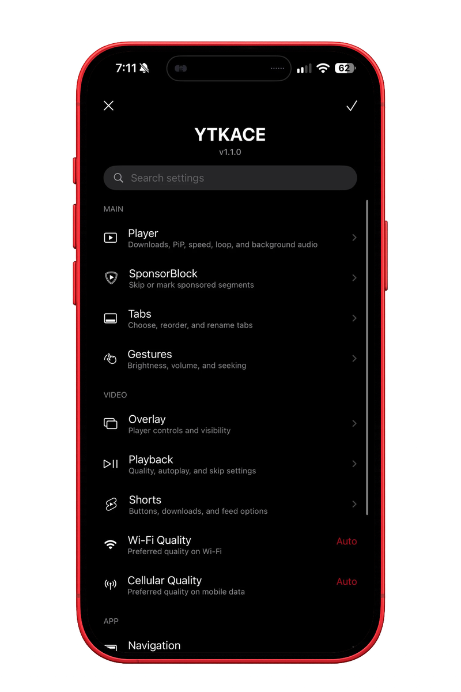
  
  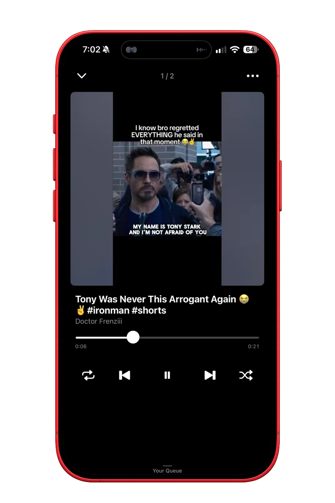
</p>

<p align="center">
  <sub>Settings · Downloads · Audio Player</sub>
</p>

<p align="center">
  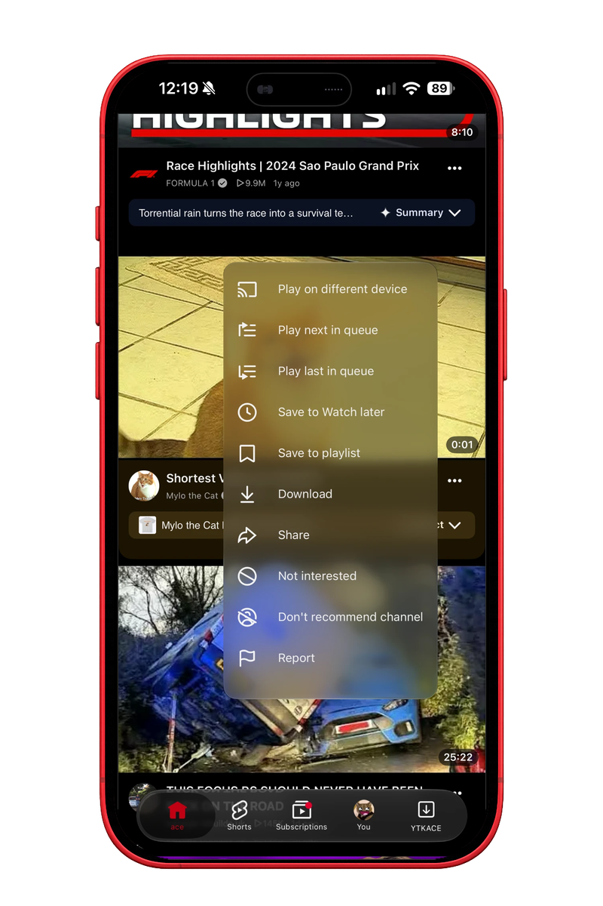
  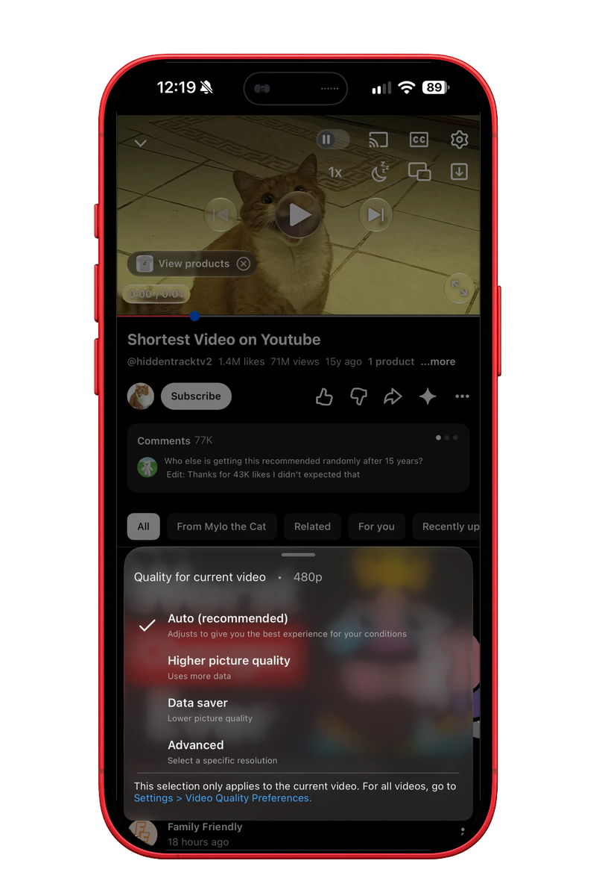
  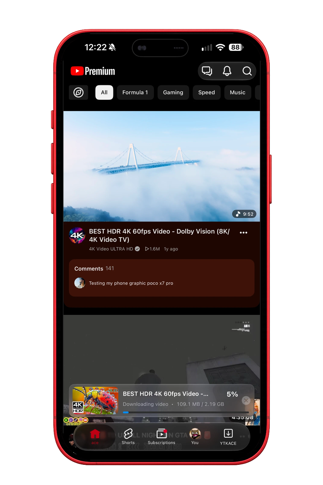
</p>

<p align="center">
  <sub>Liquid Glass · Menus · Sheets · Tab Bar</sub>
</p>

<details>
  <summary>More screenshots</summary>
  <br>
  <p align="center">
    
    
    
  </p>
  <p align="center">
    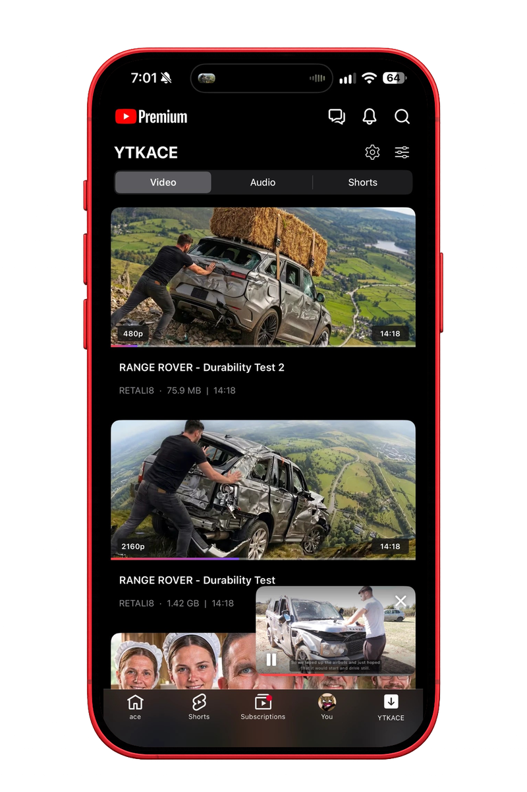
    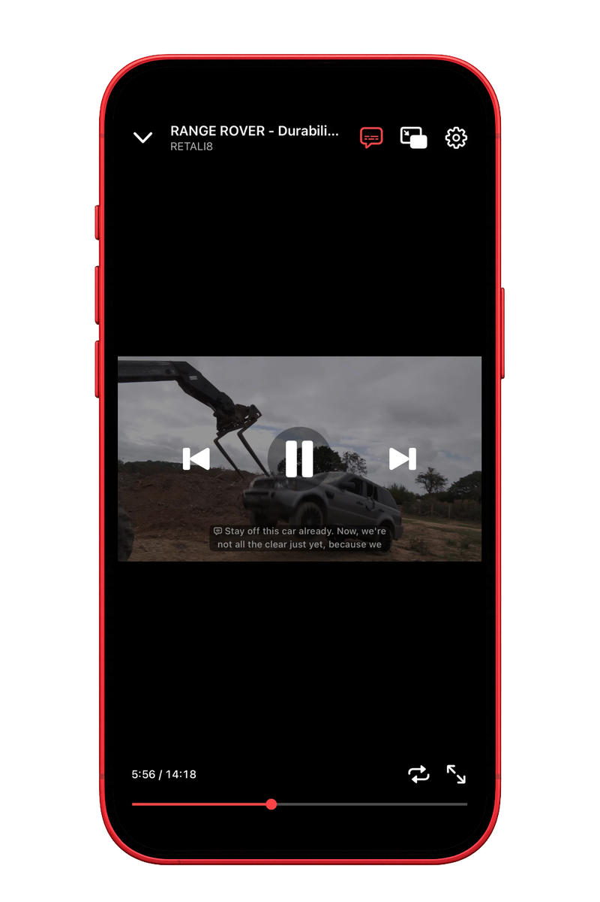
    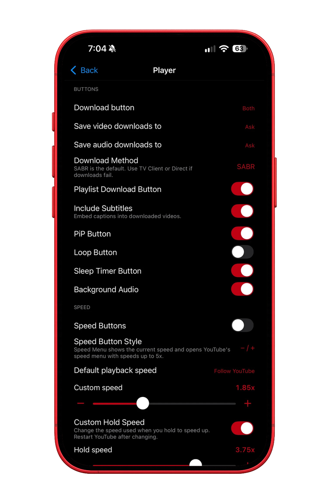
  </p>
  <p align="center">
    
    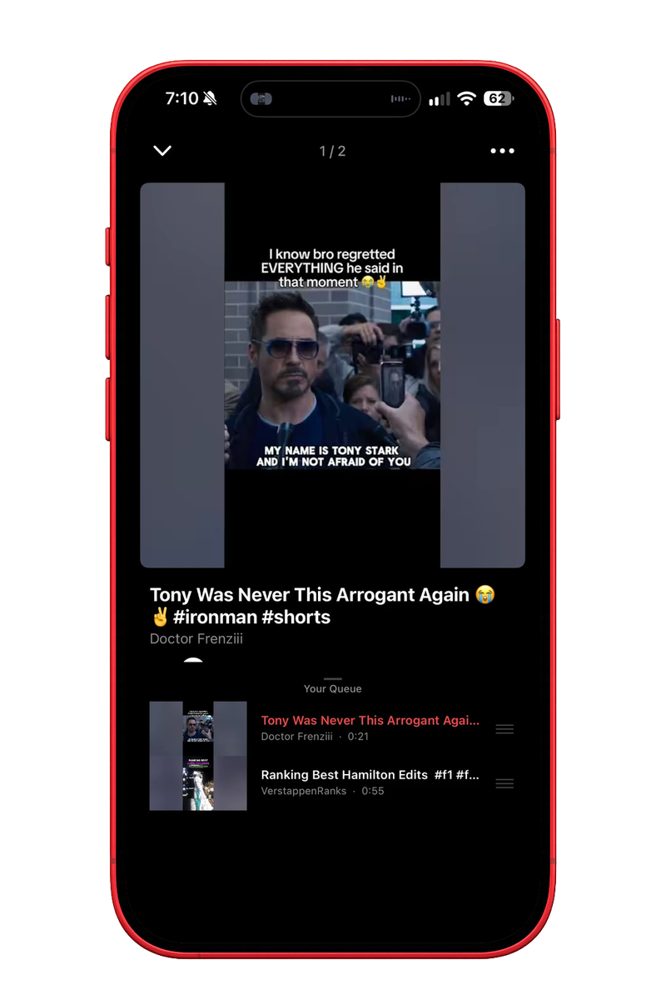
  </p>
  <p align="center">
    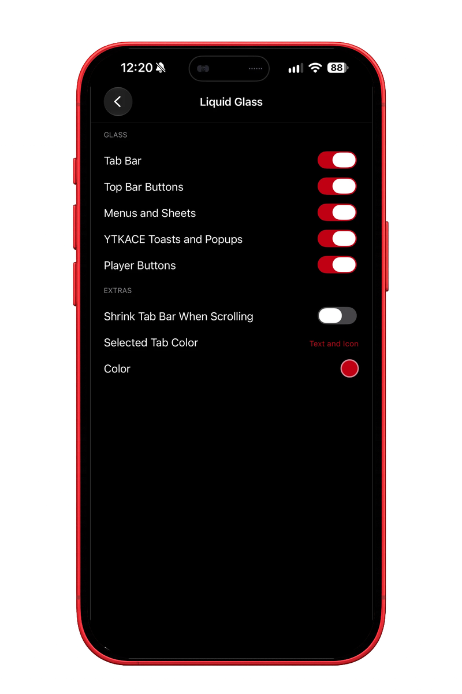
    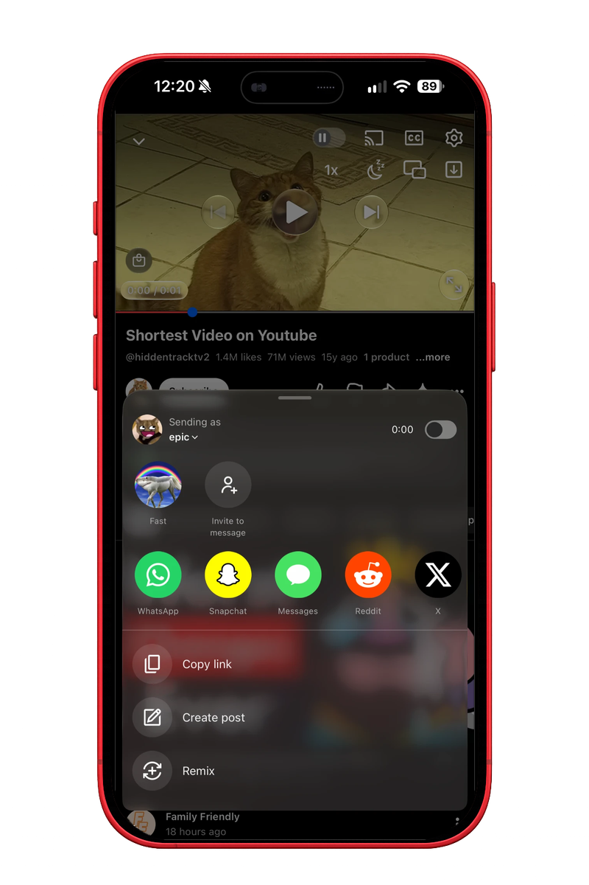
    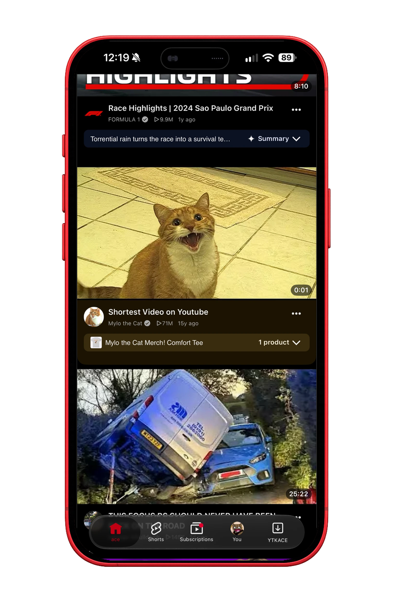
  </p>
</details>

## Privacy

YTKACE has no activation service, analytics, telemetry or updater.

## Notes

The playback fix that shipped after 0.8.0 was taken from another project without credit and has been removed. The current Playback Fix is adapted from Mark02's YTPlaybackFix under the MIT license and is credited in [THIRD_PARTY_NOTICES.md](THIRD_PARTY_NOTICES.md). If you find anything else that isn't credited, open an issue and it will be credited or removed.

## Contributing

Contributions are welcome — issues and pull requests both help.

For bug reports, include your device, iOS version and YouTube version.

For pull requests, keep each one focused on a single change and match the
surrounding style. Two things worth knowing:

- Hooks are installed by name through the helpers in `Tweak/Runtime/Hooking.h`,
  not a hooking framework, so a missing class or selector fails quietly instead
  of crashing on older YouTube versions.
- New user-facing strings go through `YTKACELocalized` and belong in
  `Resources/YTKACE.bundle/en.lproj/Localizable.strings`. Translations for the
  other 14 languages can follow separately.

Build instructions are above.

## Donate

If YTKACE is useful to you, you can support it on [Ko-fi](https://ko-fi.com/itzzace) or with crypto:

- **BTC:** `bc1q6ahl2mghgq34r3w26yhwevsza0vl8436gugxke`
- **LTC:** `LYQ2ivZ52d2zAsm896MwWEkPEi15WwprS4`

## License

YTKACE source is available under the [MIT License](LICENSE). See [Third-Party Notices](THIRD_PARTY_NOTICES.md) for components and services with separate terms.
